# VideoPulse Core

**Gated computer vision + NLP over generated and real video — with auditable evidence, not demo magic.**

VideoPulse Core processes video as a *sequence of evidence*. It samples frames, detects objects with Ultralytics YOLO26, runs five content-aware CV features, aligns timestamped transcript/log text, then fuses all of it into retrieval, entity-graph and claim-grounding results. Every one of the ten features has an explicit `can_run(context) -> (bool, reason)` gate, so a skipped feature is a reported decision rather than a silent failure.

This repository contains **two data tracks**:

1. **Generated sample track** — six deterministic, real-format `.mp4` clips across education, manufacturing and retail, plus `.srt` / `.log` side-cars. Useful for repeatable logic tests and gating behaviour.
2. **Real footage track** — four public [Intel OpenVINO sample videos](data/real/ATTRIBUTION.md) across classroom, factory, retail and facility-monitoring scenarios, processed with local `yolo26n.pt` weights. Detection-derived timestamped JSON logs become the NLP input, so text claims are grounded in the *same frames* the CV pipeline analysed.

> Honesty note: counts and rates below are copied from the reports produced by the two local runs in this working directory. They are observations, **not benchmarks or accuracy claims**.

---

## Hiring-manager snapshot

| Area | What is in the code / evidence |
|---|---|
| Computer vision | YOLO26 detection with local-only weight resolution; normalized boxes/confidence/labels/track IDs; ROI and auto-zone assignment; keyframe selection, zone energy, anomaly scoring, text-region detection and action-state indexing |
| NLP | SRT/VTT/TXT/LOG/JSON/CSV ingestion; timestamp normalization; BM25 + TF-IDF retrieval; rule/event schema parsing; NetworkX entity graph; cross-modal claim grounding |
| Real-data engineering | Four CC BY 4.0 public videos ingested from disk; detection-derived event logs; explicit `REAL_VIDEO_MISSING`, `REAL_VIDEO_UNREADABLE`, `NO_TRANSCRIPT_OR_LOG`-style status codes; corrupt files fall back instead of crashing |
| Reliability | Fail-soft detector: `yolo` when weights exist, otherwise `opencv_fallback` with `YOLO_WEIGHTS_UNAVAILABLE_OFFLINE`; every feature records latency and skip reason |
| Verification | `41` unit tests pass; 10 full reports plus one fallback report; 10 viewable result MP4s; all charts/screenshots regenerated from reports |
| Engineering judgment | No implicit downloads, no fabricated metrics, no hidden fallback, no silent skip, provenance recorded in reports and attribution file |

---

## Architecture

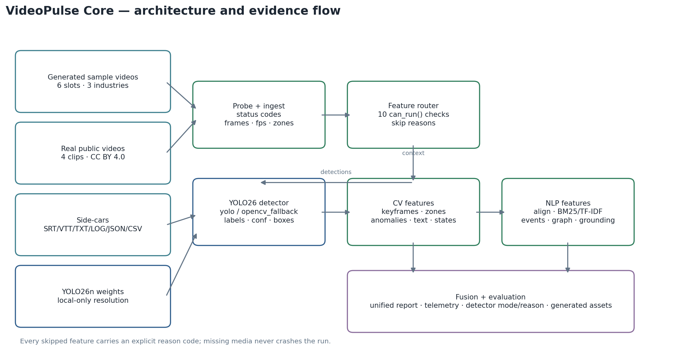

The orchestration path is deliberately small:

```text
manifest + videos + side-cars
        ↓
real/synthetic probe → DetectorResult (YOLO26 or OpenCV fallback)
        ↓
build_feature_plan → 5 CV features + 5 NLP features (explicit gates)
        ↓
fusion → report.json + telemetry + generated visual evidence
```

`core/fusion_and_eval.py` is the only place that knows the whole story. `core/yolo_detector.py` isolates model loading and result parsing, so the rest of the pipeline sees plain dictionaries. `core/real_media_ingest.py` isolates all real-media failure modes. That separation is why a corrupt `.mp4` or a missing weights file changes a status field instead of killing the process.

---

## Viewable CV + NLP result videos

Every processed input — all 6 generated clips and all 4 real clips — now has its own annotated MP4, not just a JSON report.

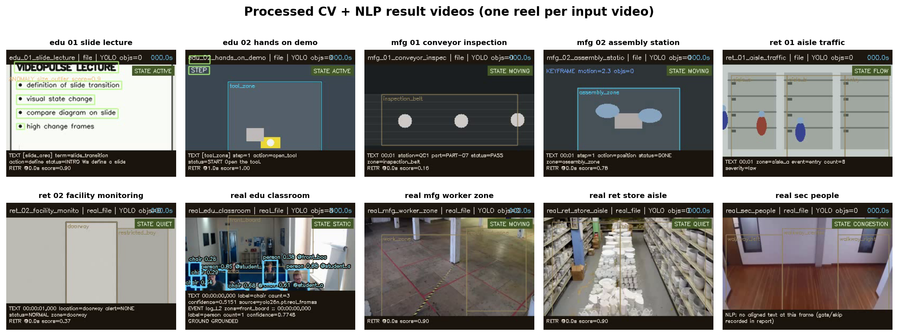

Each reel steps through the exact sampled frames used by the pipeline and overlays:

- **amber boxes** — YOLO26 object label + confidence (or OpenCV fallback boxes),
- **cyan/yellow zones** — manifest ROIs, brighter when active at that timestamp,
- **green rectangles** — detected on-screen text regions,
- **callouts** — selected keyframe, anomaly kind/score and current action state,
- **bottom caption** — timestamp-aligned transcript/log line, parsed event, grounding verdict and top retrieval hit.

| Generated track reels | Real footage reels |
|---|---|
| [edu_01_slide_lecture](docs/videos/generated/edu_01_slide_lecture_cv_nlp.mp4) | [real_edu_classroom](docs/videos/real/real_edu_classroom_cv_nlp.mp4) |
| [edu_02_hands_on_demo](docs/videos/generated/edu_02_hands_on_demo_cv_nlp.mp4) | [real_mfg_worker_zone](docs/videos/real/real_mfg_worker_zone_cv_nlp.mp4) |
| [mfg_01_conveyor_inspection](docs/videos/generated/mfg_01_conveyor_inspection_cv_nlp.mp4) | [real_ret_store_aisle](docs/videos/real/real_ret_store_aisle_cv_nlp.mp4) |
| [mfg_02_assembly_station](docs/videos/generated/mfg_02_assembly_station_cv_nlp.mp4) | [real_sec_people](docs/videos/real/real_sec_people_cv_nlp.mp4) |
| [ret_01_aisle_traffic](docs/videos/generated/ret_01_aisle_traffic_cv_nlp.mp4) | |
| [ret_02_facility_monitoring](docs/videos/generated/ret_02_facility_monitoring_cv_nlp.mp4) | |

Rebuild all reels with `python tools/render_result_videos.py`. To scale this to hundreds of legally obtained clips, follow [`docs/VIDEO_ASSET_GUIDE.md`](docs/VIDEO_ASSET_GUIDE.md).

These are analysis reels built from 24–25 sampled frames per clip, not dense full-length re-encodes. That keeps them small, reviewable and honest about what the pipeline actually analysed.

---

## What the pipeline actually does

### CV side

- **Motion keyframe extraction** — frame-difference scoring with object labels/count/confidence attached when a detector is active.
- **ROI zone tracking** — manifest ROIs or detector-derived grid zones; per-zone motion energy and object counts.
- **Visual anomaly scoring** — scene change plus object rarity, out-of-context label, size and count outliers.
- **On-screen text detection** — OpenCV region proposals with optional object cues; honestly skipped when no text region exists.
- **Action-state indexing** — state vocabulary driven by motion and object counts, e.g. `QUIET → FLOW → CONGESTION`.

### NLP side

- **Transcript/log alignment** — `HH:MM:SS,mmm`, `MM:SS`, numeric epoch-relative offsets and JSON/CSV field timestamps.
- **Multimodal BM25 + TF-IDF retrieval** — text and CV-derived tokens in one index.
- **Rule/schema event parsing** — extracts entity, action, status, zone, defect and step fields.
- **Entity graph linking** — `AT_ZONE`, `HAS_ACTION`, `SUPPORTED_BY_OBJECT`, `DETECTED_IN` style relations.
- **Grounding consistency check** — a claim is grounded only when timestamp, zone and evidence agree; object labels such as `object:person` count as supporting evidence.

### Content-aware gating

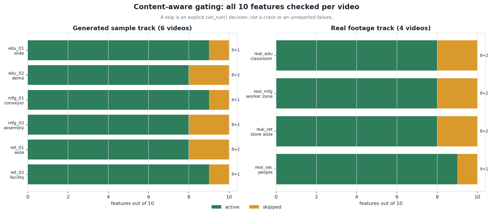

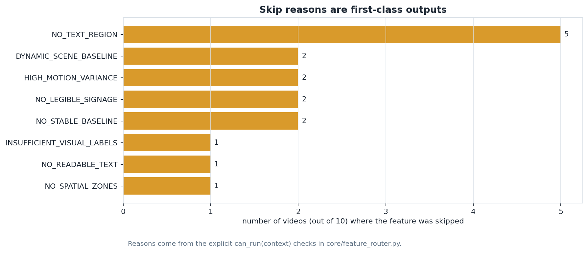

Examples of real gating decisions from the current reports:

| Video | Skipped features (reason) |
|---|---|
| `edu_01_slide_lecture` | `roi_zone_tracking (NO_SPATIAL_ZONES)` |
| `edu_02_hands_on_demo` | `visual_anomaly_scoring (NO_STABLE_BASELINE)`, `grounding_consistency_check (INSUFFICIENT_VISUAL_LABELS)` |
| `mfg_01_conveyor_inspection` | `on_screen_text_detection (NO_READABLE_TEXT)` |
| `ret_01_aisle_traffic` | `visual_anomaly_scoring (DYNAMIC_SCENE_BASELINE)`, `on_screen_text_detection (NO_LEGIBLE_SIGNAGE)` |
| `real_edu_classroom` | `visual_anomaly_scoring (NO_STABLE_BASELINE)`, `on_screen_text_detection (NO_TEXT_REGION)` |
| `real_mfg_worker_zone` | `visual_anomaly_scoring (HIGH_MOTION_VARIANCE)`, `on_screen_text_detection (NO_TEXT_REGION)` |
| `real_sec_people` | `on_screen_text_detection (NO_TEXT_REGION)` |

That distinction matters: “no readable text” and “high motion variance” are different product decisions with different downstream consequences.

---

## Generated-data track (Phase 1 baseline)

Six deterministic clips cover the original 10-feature suite. Regenerate them with:

```bash
python run_pipeline.py --generate-samples
python run_pipeline.py --all --query "defect alert slide step"
```

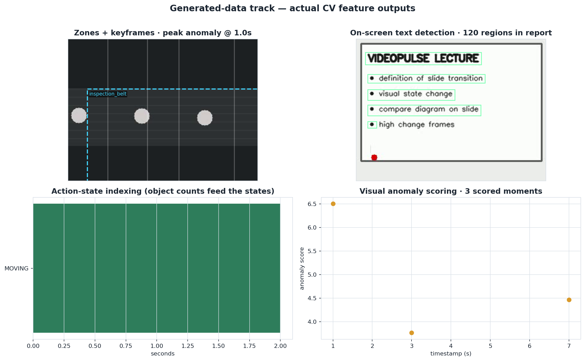

Sample report: [`docs/reports/generated/mfg_01_conveyor_inspection.json`](docs/reports/generated/mfg_01_conveyor_inspection.json) · [`docs/reports/generated/ret_02_facility_monitoring.json`](docs/reports/generated/ret_02_facility_monitoring.json)

In the current local run, the generated clips were also processed with the local YOLO26 weights; the detector mode is recorded per report. The offline fallback is kept as a separate, verified path: [`docs/reports/fallback/ret_02_facility_monitoring.json`](docs/reports/fallback/ret_02_facility_monitoring.json) shows `detector_mode: opencv_fallback` with reason `YOLO_WEIGHTS_UNAVAILABLE_OFFLINE`.

---

## Real-data track (Phase 2)

### Source footage

| Local clip | Scenario | Upstream source |
|---|---|---|
| `classroom.mp4` | Education | [Intel sample-videos / classroom](https://github.com/intel-iot-devkit/sample-videos/blob/master/classroom.mp4) |
| `worker-zone-detection.mp4` | Manufacturing / safety zone | [Intel sample-videos / worker-zone](https://github.com/intel-iot-devkit/sample-videos/blob/master/worker-zone-detection.mp4) |
| `store-aisle-detection.mp4` | Retail traffic | [Intel sample-videos / store aisle](https://github.com/intel-iot-devkit/sample-videos/blob/master/store-aisle-detection.mp4) |
| `people-detection.mp4` | Facility monitoring | [Intel sample-videos / people detection](https://github.com/intel-iot-devkit/sample-videos/blob/master/people-detection.mp4) |

See [`data/real/ATTRIBUTION.md`](data/real/ATTRIBUTION.md) for the CC BY 4.0 attribution and derived-data note. Videos and weights are git-ignored because they are binaries; the commands below recreate them.

```bash
# 1. Fetch public videos + local YOLO26n weights (only when missing).
python tools/prepare_real_data.py --download

# 2. Rebuild detection-derived timestamped JSON logs from the real frames.
python tools/prepare_real_data.py --force

# 3. Run the full CV+NLP suite on real footage.
python run_pipeline.py --all \
  --manifest config/real_videos_manifest.json \
  --real-dir data/real/videos \
  --logs-dir data/real/logs \
  --output-dir outputs/real \
  --model yolo26n.pt \
  --query "person zone worker shopper classroom"

# 4. Rebuild every figure/screenshot in this README from the generated reports.
python tools/build_readme_assets.py
```

### Real YOLO26 frames

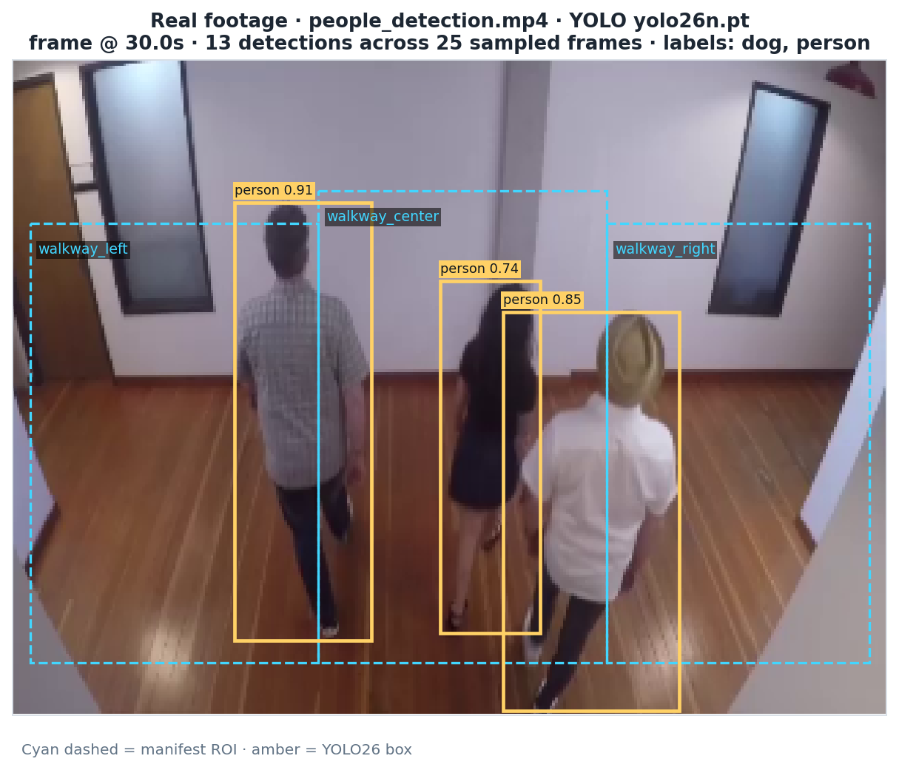

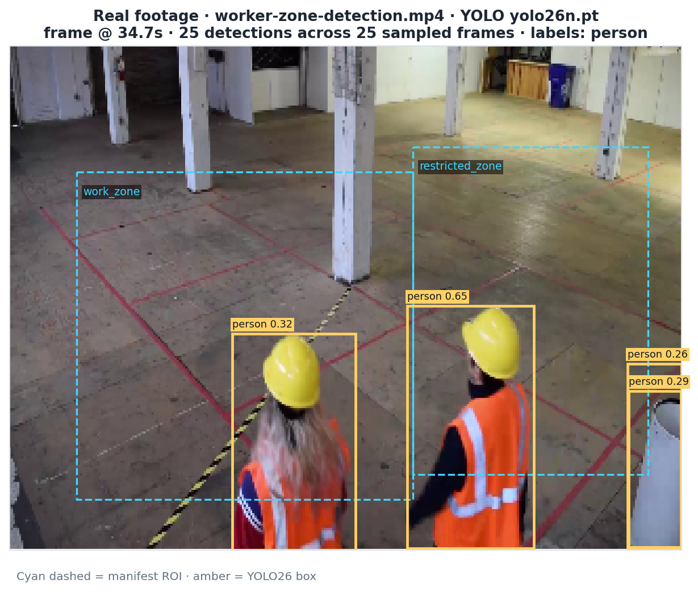

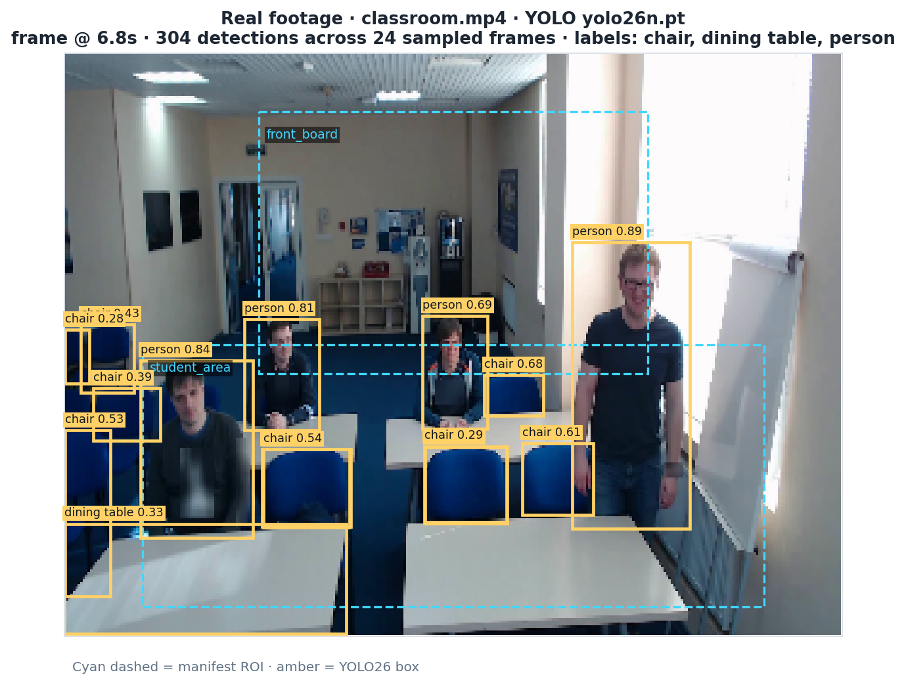

The overlays above are drawn from actual `DetectorResult` output: cyan dashed rectangles are manifest ROIs, amber rectangles are YOLO26 boxes with label and confidence.

### Real CV → NLP evidence

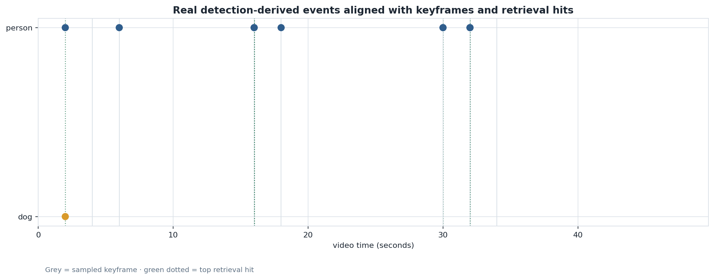

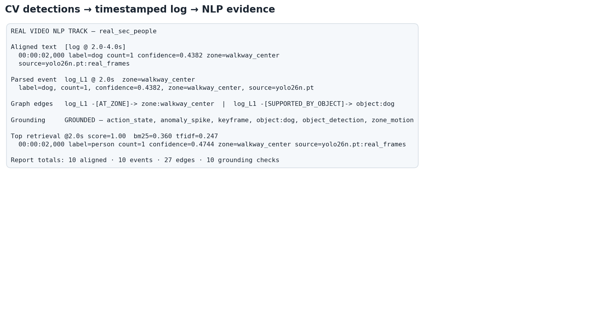

For `real_sec_people`, the NLP side consumed 10 detection-derived events, produced 27 graph edges and 10 grounding checks, and the top retrieval hit scored `1.00` at `2.0s`. The grounding record explicitly lists `object:dog` / `object:person` alongside `keyframe`, `anomaly_spike` and `zone_motion` evidence. See the full report: [`docs/reports/real/real_sec_people.json`](docs/reports/real/real_sec_people.json).

---

## Measured results from the local runs

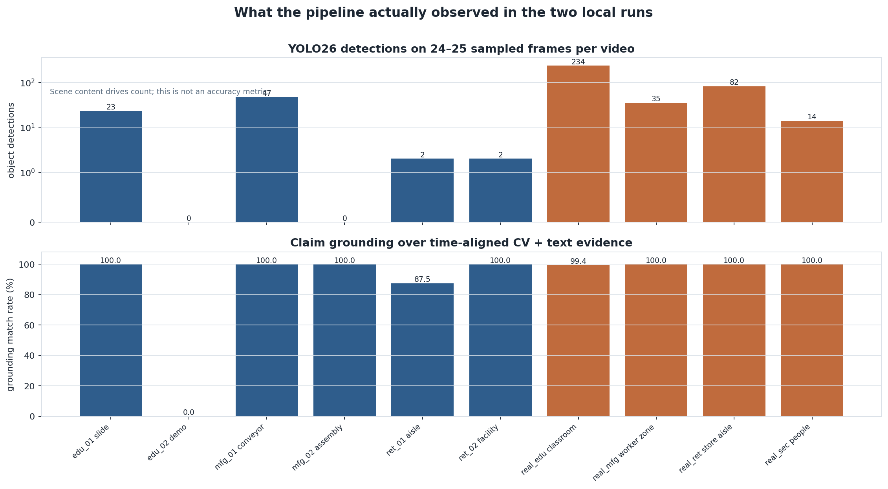

| Track | Videos | Detector | Object detections (per video) | Grounding match rate |
|---|---:|---|---|---|
| Generated samples | 6 | `yolo` / `weights:yolo26n.pt` | 0–47 per video (report order: 23, 0, 47, 0, 2, 2) | 0.00–1.00 (scene dependent) |
| Real public footage | 4 | `yolo` / `weights:yolo26n.pt` | 14, 35, 82, 234 | 0.994–1.00 |
| Offline fallback check | 1 | `opencv_fallback` | Phase 1 blob detector | report records reason and telemetry |

Grounding is intentionally allowed to be low when a scene has no stable visual labels; `edu_02_hands_on_demo` skips grounding with `INSUFFICIENT_VISUAL_LABELS` rather than inventing a score.

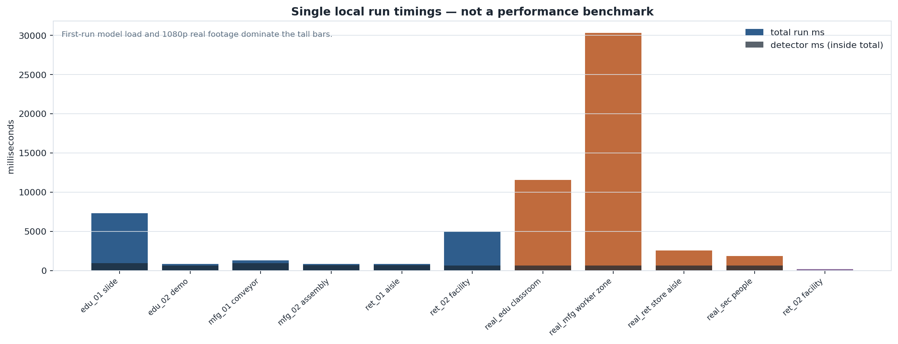

The timing chart is labelled as a **single local run, not a benchmark**. First-run model loading and 1080p real footage dominate the tall bars; detector time is shown inside total time.

---

## Verification already performed

```text
python -m unittest discover -s tests -v
Ran 41 tests ... OK

python run_pipeline.py --all --query "defect alert slide step"
6/6 generated reports written

python run_pipeline.py --all --manifest config/real_videos_manifest.json \
  --real-dir data/real/videos --logs-dir data/real/logs \
  --output-dir outputs/real --model yolo26n.pt \
  --query "person zone worker shopper classroom"
4/4 real reports written, media.source = real_file, detector_mode = yolo

python tools/build_readme_assets.py
verified 12 images

python tools/render_result_videos.py
wrote 10 result videos and contact sheet
```

The deliberately corrupt `.mp4` fixture emits standard FFmpeg `moov atom not found` stderr during tests; that is the negative-path test, not a failed run.

---

## Repository map

```text
config/videos_manifest.json        Generated six-video manifest
config/real_videos_manifest.json   Real public-video manifest
core/real_media_ingest.py          Real video/sidecar discovery, parsing, status codes
core/yolo_detector.py              YOLO26 wrapper + strict offline fallback
core/media_probe.py                Probe/context shared by both tracks
core/feature_router.py             Ten explicit can_run() gates
core/cv_pipeline.py                Five CV features
core/nlp_pipeline.py               Five NLP features
core/fusion_and_eval.py            Orchestration, telemetry, report writing
tools/prepare_real_data.py         Build real detection-derived event logs
tools/build_manifest_from_folder.py  Turn any video folder into a bulk manifest
tools/build_readme_assets.py       Regenerate figures/screenshots from reports
tools/render_result_videos.py      Render one annotated CV+NLP MP4 per video
tests/                             41 tests across both phases, links and reels
docs/VIDEO_ASSET_GUIDE.md          How to acquire hundreds of licensed video clips
docs/figures/                      Architecture, measurement charts and contact sheet
docs/screenshots/                  Real/generated frame and NLP evidence assets
docs/videos/                       10 processed CV+NLP result MP4s
docs/reports/                      Copies of the actual JSON reports linked above
data/real/ATTRIBUTION.md           Real-data provenance and license
```

---

## Known limits

- Real video/weights are not committed; they are fetched by the explicit `--download` command. The pipeline never downloads weights implicitly.
- OCR text recognition is not bundled (no Tesseract binary in this environment); text *regions* are detected and reported as such.
- Detections are from 24–25 sampled frames per clip, not dense full-video inference.
- Latency numbers come from one machine and one run; they are not a throughput guarantee.

## Attribution

Real footage: [Intel OpenVINO sample-videos](https://github.com/intel-iot-devkit/sample-videos), CC BY 4.0 — details in [`data/real/ATTRIBUTION.md`](data/real/ATTRIBUTION.md). Model weights: [Ultralytics YOLO26 release assets](https://github.com/ultralytics/assets/releases).
